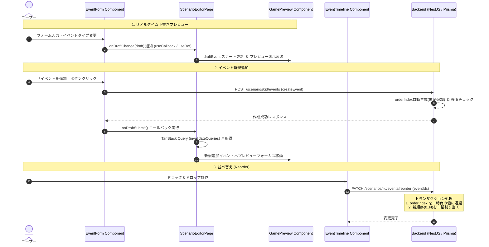

# イベント仕様および運用・追加フローガイド (Event Specification & Workflow)

本ドキュメントは、Novel Dashboard システムにおける**演出イベント（Event）**の種類、パラメータ構造、データモデル、および作成・編集・プレビュー・並べ替えの全体の処理フローについてまとめた仕様書です。

---

## 1. 概要 (Overview)

Novel Dashboard において、ノベルゲーム等のシナリオは「シナリオ（Scenario）」に属する複数の**「演出イベント（Event）」の時系列順のシーケンス**として表現されます。  
各イベントは、テキスト表示、背景変更、音響再生、分岐選択肢などの演出命令を保持します。

---

## 2. イベント種別とパラメータ仕様 (Event Types & Parameters)

イベントは `eventType` と構造化JSONデータ `data` によって定義され、イベント種別ごとに意味のあるフィールド名（判別共用体 `EventPayload`）を持ちます。

| 種別 (`eventType`) | ラベル | 役割 | `data` 構造 (`EventDataMap[eventType]`) | 主なフィールド説明 |
| :--- | :--- | :--- | :--- | :--- |
| `text` | 💬 会話・セリフ | キャラクターの発言・地の文を表示 | `{ speaker?: string; text: string }` | `speaker`: 話者・キャラクター名<br>`text`: セリフ・本文 |
| `bg_change` | 🖼️ 背景変更 | プレビュー画面・ゲーム画面の背景を変更 | `{ image: string; effect?: string }` | `image`: 背景画像 ID / パス / URL / キーワード<br>`effect`: 切替効果 (`fade`, `instant` 等) |
| `bgm_play` | 🎵 BGM再生 | バックグラウンドミュージックの再生・変更 | `{ bgmId: string; option?: string }` | `bgmId`: BGM名 / 音源ファイルID<br>`option`: 再生オプション (`loop`, `volume:80` 等) |
| `sound_effect` | 🔊 効果音 (SE) | ワンショット効果音の再生 | `{ seId: string }` | `seId`: SE音源名 / ファイルID |
| `selection` | 🔀 分岐・選択肢 | プレイヤーへの選択肢提示 | `{ choices: string[] }` | `choices`: 選択肢テキストの配列 |
| `custom` | ⚙️ カスタムコマンド | 独自拡張コマンド | `{ params: string[] }` | `params`: カスタム引数の配列 |

---

## 3. データ構造と型定義 (Data Models & Type Definitions)

### 3.1 データベースモデル (Prisma Schema)

データベース上では `Event` テーブルとして管理され、イベント固有のパラメータは `data` (`Json` 型) カラムに格納されます。また、シナリオ内での表示順を示す `orderIndex` に複合ユニーク制約 (`@@unique([scenarioId, orderIndex])`) が掛けられています。

```prisma
model Event {
  id         Int       @id @default(autoincrement())
  scenarioId Int
  scenario   Scenario  @relation(fields: [scenarioId], references: [id], onDelete: Cascade)
  orderIndex Int       @default(0)
  eventType  String
  data       Json      @default("{}")

  createdAt  DateTime  @default(now())
  updatedAt  DateTime  @updatedAt

  @@unique([scenarioId, orderIndex])
}
```

### 3.2 フロントエンド型定義 (TypeScript)

`frontend/types/index.ts` にて、`EventDataMap` をベースにした判別共用体（Discriminated Union）として定義されています。

```typescript
export type EventDataMap = {
  text: { speaker?: string; text: string };
  bg_change: { image: string; effect?: string };
  bgm_play: { bgmId: string; option?: string };
  sound_effect: { seId: string };
  selection: { choices: string[] };
  custom: { params: string[] };
};

export type EventType = keyof EventDataMap;

export type EventPayload = {
  [K in EventType]: {
    eventType: K;
    data: EventDataMap[K];
  };
}[EventType];

// 保存済みイベントオブジェクト
export type Event = {
  id: number;
  scenarioId: number;
  orderIndex: number;
  createdAt?: string;
  updatedAt?: string;
} & EventPayload;

// フォーム入力時・リアルタイムプレビュー用の下書きオブジェクト
export type DraftEvent = {
  [K in EventType]: {
    eventType: K;
    data: Partial<EventDataMap[K]>;
  };
}[EventType];
```

---

## 4. イベントの処理・操作フロー (Event Operations Workflow)

イベントの作成、ドラッグ＆ドロップによる並べ替え、編集、削除、および下書きプレビューの全体フローは以下の通りです。



### 4.1 下書き連動 (Draft Preview)
- `EventForm` の入力が更新されるたびに `useEffect` 経由で親 (`page.tsx`) に `onDraftChange` が送信されます。
- 親の `draftEvent` ステートが更新され、`GamePreview` に即座に下書き内容（文字、演出、背景等）が表示されます。
- **パフォーマンス・安定性**: `onDraftChange` は `useCallback` / `useRef` で制御され、再レンダリング無限ループを防いでいます。

### 4.2 イベント新規追加 (Creation)
1. ユーザーが `EventForm` で送信を実行。
2. バックエンド `EventService.create()` は、対象シナリオ内の既存イベント数をカウント (`count`) し、これを新しい `orderIndex` に割り当てます。
3. 保存成功後、フロントエンドは `invalidateQueries(["events", scenarioId])` を発行して最新タイムラインを取得し、フォーカスを末尾へ移動します。

### 4.3 並べ替え (Reorder)
1. `EventTimeline` 上で HTML5 Drag and Drop を用いて項目の順序を変更します。
2. `reorderEvents` API に並び替えた `eventIds` の配列を送信します。
3. **バックエンドでの重複制約回避テクニック**:
   複合ユニーク制約 `[scenarioId, orderIndex]` に衝突しないよう、Prisma トランザクション内で一度すべての対象イベントの `orderIndex` を**一時的に負の値 (`-(orderIndex + 1)`) に退避**してから、新しい `orderIndex` (0 〜 N-1) を昇順で再割り当てします。

### 4.4 編集および削除 (Update / Delete)
- **編集**: `EventTimeline` 内の編集ボタンから `EventEditModal` を開き、`PATCH /events/:id` でパラメータを更新します。
- **削除**: 削除ボタン押下時、確認モーダルを経て `DELETE /events/:id` が実行されます（バックエンド側で OWNER 権限チェックが行われます）。

---

## 5. ビジュアル・プレビュー処理 (GamePreview System)

`GamePreview` コンポーネントは、保存済みイベントシーケンスまたは下書きイベントを受け取り、以下のビジュアルレンダリングを行います。

1. **背景自動推定 (Background Deduction)**
   - `data.image` に指定されたキーワード (`classroom`, `sunset`, `night`, `forest`, `sea`, `rain` 等) または画像URLから適切なグラデーション / 背景画像を判定・適用します。
2. **演出・テキスト表現**
   - 話者名（`data.speaker`）とセリフ（`data.text`）のアニメーション表示。
   - 選択肢（`selection` の `data.choices`）のボタンオーバーレイ描画。

---

## 6. パラメータ設計の課題と今後のリファクタリング方針 (Parameter Design & Refactoring Guidelines)

現在は `param1` 〜 `param6` の汎用パラメータを `eventType` に応じて使い分ける方式を採用していますが、機能拡張に伴い以下の課題と設計方針を考慮する必要があります。

### 6.1 現状（`param1` 〜 `param6` 使い回し）の課題

1. **可読性・保守性の低下**
   - `GamePreview.tsx` や `EventTimeline.tsx` において、`param1` が「話者名」なのか「背景画像ID」なのかを毎回 `eventType` の条件分岐と照らし合わせる必要があります。
   - `EventEditModal.tsx` では用途別のラベル分岐が適用されておらず、`param1` 〜 `param6` が汎用入力欄のまま表示されています。
2. **フォームで `eventType` を切り替えた際の値の混入・残留**
   - `EventForm.tsx` で `param1` 〜 `param6` の state を共有しているため、例えば「分岐・選択肢 (`selection`)」で `param3`（選択肢3）を入力したあとに「会話 (`text`)」へ切り替えて保存すると、画面上は非表示の `param3` の値がそのままDBへ送信されてしまいます。
3. **配列や7個以上のパラメータへの拡張限界**
   - 「選択肢を4つ以上に増やしたい」「選択肢ごとにジャンプ先シナリオIDを持たせたい」「立ち絵（キャラクターID・表情・位置・演出）を追加したい」といった構造化データや可変長データの表現が困難です。

---

### 6.2 設計パターンの比較

「すべての用途ごとに変数を分けるべきか？」という問いに対しては、**単純に全用途の変数をフラットに並べるのではなく、イベント種別ごとの名前付きオブジェクト（判別共用体 / JSON）に分離する設計**が推奨されます。

| パターン | 概要 | 評価 | メリット・デメリット |
| :--- | :--- | :---: | :--- |
| **パターンA**<br>全用途の個別カラム・個別state化 | `speaker`, `dialogue`, `bgImage`, `bgEffect`, `bgmName` 等をすべてフラットに並べる | ❌ 非推奨 | ・イベント種別追加のたびにDBマイグレーションが必要<br>・常に大半のカラムが `NULL` になる<br>・フロントエンドの `useState` やリセット処理が肥大化する |
| **パターンB**<br>判別共用体 (Discriminated Union) ＋ DB `Json` カラム化 | DBの `param1`〜`param6` を `data Json` カラム1つに統合し、TS側で `eventType` 別の型を定義する | ⭕ 最も推奨 | ・`event.data.speaker` や `event.data.choices` のように用途名で安全にアクセス可能<br>・TypeScriptの型補完・チェックが効く<br>・選択肢の配列化や新規イベント種別追加でもDBスキーマ変更が不要 |
| **パターンC**<br>DBは維持し、フロントエンドのみ用途別型に変換 | DB・APIは `param1`〜`param6` のまま維持し、フロントエンドの変換関数とフォームstateのみ分離する | ⚖️ 折衷案 | ・バックエンド・DBを変更せずにフロントエンドの可読性と混入バグを改善可能<br>・ただしパラメータ数（最大6個）や配列構造の制限は残る |

---

### 6.3 推奨される型設計例（パターンBの場合）

#### Prisma スキーマ (`schema.prisma`)
```prisma
model Event {
  id         Int      @id @default(autoincrement())
  scenarioId Int
  scenario   Scenario @relation(fields: [scenarioId], references: [id], onDelete: Cascade)
  orderIndex Int      @default(0)
  eventType  String
  data       Json     // イベント種別ごとの構造化データを保持

  createdAt  DateTime @default(now())
  updatedAt  DateTime @updatedAt

  @@unique([scenarioId, orderIndex])
}
```

#### フロントエンド型定義 (`frontend/types/index.ts`)
```typescript
export type EventPayload =
  | { eventType: "text"; data: { speaker?: string; text: string } }
  | { eventType: "bg_change"; data: { image: string; effect?: string } }
  | { eventType: "bgm_play"; data: { bgmId: string; option?: string } }
  | { eventType: "sound_effect"; data: { seId: string } }
  | { eventType: "selection"; data: { choices: string[] } }
  | { eventType: "custom"; data: { params: string[] } };
```

---

### 6.4 改修時の進め方ガイド

- **今後イベントの種類や機能（立ち絵、分岐先指定など）を拡張する予定がある場合**:
  - **パターンB（DBの `Json` カラム化 ＋ フロントエンドの判別共用体定義）** への移行を推奨します。
- **バックエンドやDB構造を現状のまま固定したい場合**:
  - **パターンC** を採用し、`frontend/lib/api.ts` でのマッパー関数の導入、`EventForm.tsx` での `eventType` 切り替え時の未使用パラメータクリア、および `EventEditModal.tsx` の用途別入力フォーム化を行うことを推奨します。

